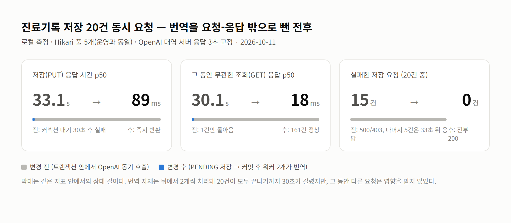
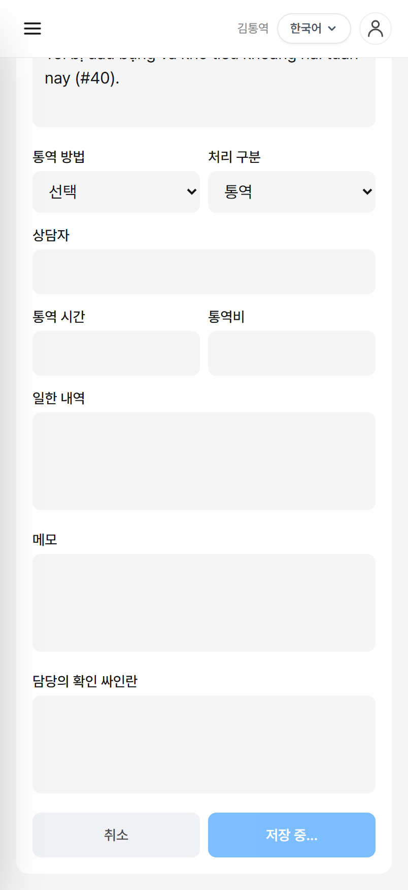
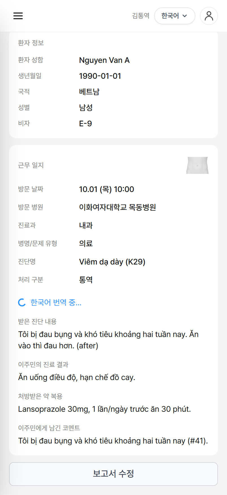
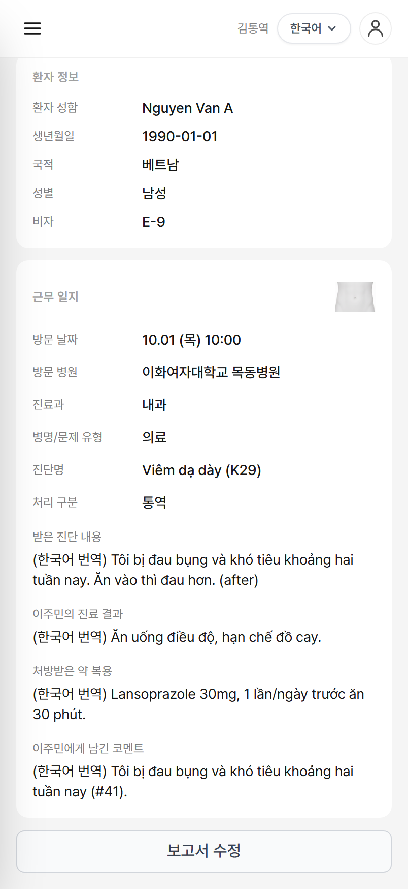

# Cura 번역 파이프라인을 요청-응답 밖으로 빼기 — Lambda 도입 1단계와 측정

앞 글에서 Cura 백엔드에서 Lambda 로 떼어낼 만한 일로 세 가지를 꼽았다. Gemini 번역·요약 파이프라인, 처방전·검사지 OCR, 예약 작업. 이 글은 그중 첫 번째를 실제로 떼어낸 기록이다. 코드를 열어 보니 앞 글의 전제 몇 가지가 틀려 있었고, "스레드가 묶인다"는 걱정보다 훨씬 구체적인 사고가 이미 코드 안에 있었다. 그 사고를 재현해 숫자로 보고, 번역을 비동기 워커로 옮긴 뒤 같은 숫자를 다시 쟀다. Lambda 가 할 일을 Spring 안의 워커로 먼저 만들고, 그 워커를 그대로 옮긴 Lambda 함수를 SAM 으로 실제 AWS 에 올리는 데까지 갔다. 올리고 나서 첫 호출이 어디서 멈췄는지도 그대로 적었다. 운영 트래픽을 Lambda 로 넘기고 요금을 재는 건 다음 글이다.

## 먼저 바로잡을 사실 세 가지

앞 글은 머릿속 그림이었고, 코드는 조금 달랐다.

- **Gemini 가 아니라 OpenAI 다.** `OpenAiApiConfig` 가 `api.openai.com` 으로 붙고 모델은 `gpt-4o-mini` 다. README 에도 Gemini 라고 적혀 있어 같이 틀렸다. 설계에는 영향이 없다.
- **파일 업로드·OCR 은 아직 없다.** `MultipartFile` 을 받는 코드가 0건이다. 앞 글의 2번은 "떼어내기"가 아니라 신규 기능이다.
- **번역은 생성 시가 아니라 수정 시에만 돈다.** 통번역가가 보고서를 저장(`PUT /consultations/{id}`)할 때 환자 모국어로 적힌 항목을 한국어로 번역해 `translated_*` 컬럼에 둔다.

그래서 이번 글의 대상은 하나다. 보고서 저장 요청 안에서 동기로 돌던 OpenAI 호출.

## 지금 코드가 막히는 방식

앞 글에서는 "Gemini 응답을 기다리는 동안 톰캣 스레드가 묶인다"고 썼다. 틀린 말은 아니지만 Cura 에서 먼저 터지는 건 스레드가 아니라 DB 커넥션이었다.

`ConsultationService.update()` 는 `@Transactional` 이고, 그 안에서 `TranslationService.translateToKorean()` 을 동기로 부른다. 트랜잭션이 열려 있는 동안 Hikari 커넥션 하나가 점유된다. 운영 설정의 풀 크기는 5 다. Supabase 무료 티어가 PgBouncer 뒤에서 서버 커넥션 60개를 나눠 쓰기 때문에 작게 잡아둔 값이다.

여기에 하나가 더 겹친다. 번역이 끝나면 "진료 내용이 국외(OpenAI)로 이전됐다"는 감사기록을 `AuditService.recordThirdPartyTransfer()` 로 남기는데, 이 메서드는 `REQUIRES_NEW` 다. 감사기록은 본 트랜잭션이 롤백돼도 남아야 하니 맞는 선택이다. 그런데 `REQUIRES_NEW` 는 **두 번째 커넥션**을 요구한다. 첫 커넥션을 쥔 채로.

저장 요청이 동시에 5개 오면 이렇게 된다.

1. 5개 요청이 커넥션 5개를 하나씩 잡고 각자 OpenAI 를 기다린다. 풀은 비었다.
2. 3초 뒤 번역이 돌아오고, 5개 요청이 각자 감사기록용 두 번째 커넥션을 달라고 한다.
3. 줄 커넥션이 없다. 5개가 서로가 놓아주길 기다린다. 아무도 놓지 않는다.
4. `connection-timeout`(운영 10초, 로컬 기본 30초) 뒤 예외. 그 사이 들어온 모든 요청, 로그인·목록 조회까지 전부 같이 기다렸다.

풀 크기만큼의 동시 저장만으로 서버 전체가 멈추는 교착이다. 4건까지는 멀쩡하다. 5건째부터 터진다.

### 재현

로컬에서 운영과 같은 조건을 만들었다. Postgres 는 Docker, Hikari 풀은 5, OpenAI 자리에는 3초 기다렸다가 응답하는 대역 서버를 두고, 통번역가 토큰으로 보고서 저장을 동시에 N 건 보내면서 150ms 간격으로 무관한 조회를 같이 날렸다.

| 동시 저장 | 저장 응답 p50 | 그동안 무관한 GET p50 | OpenAI 실제 호출 | 결과 |
|---|---|---|---|---|
| 4건 | 3.1초 | 27ms | 4 | 정상 |
| 5건 | 33.1초 | 2.8초 | 5 | 전부 30초 대기 후 응답 |
| 20건 | 33.1초 | 30.1초 (1건만 돌아옴) | 5 | 15건 500/403, 5건은 33초 뒤 응답 |

20건을 보냈는데 OpenAI 호출은 5번뿐이다. 나머지 15건은 OpenAI 근처에도 못 가고 커넥션을 기다리다 죽었다. 로그에는 같은 줄이 반복된다.

```
HikariPool-1 - Connection is not available, request timed out after 30008ms (total=5, active=5, idle=0, waiting=20)
```

브라우저에서는 이렇게 보인다. 저장 20건이 몰린 동안 다른 사용자가 목록 화면을 열면 스피너가 31.9초 동안 돈다.


## 어떻게 바꿨나

원칙은 앞 글에서 정한 그대로다. 저장은 즉시 돌려주고, 기다리는 일은 다른 곳에서 한다. 다만 그 "다른 곳"을 처음부터 Lambda 로 두지 않고, 같은 JVM 안의 작은 워커로 먼저 만들었다. 비동기 계약(상태 컬럼, 멱등성, 폴링)을 Spring 안에서 확정해 두면 2단계에서 워커의 위치만 바뀐다.

### 상태 컬럼과 버전

```sql
ALTER TABLE consultation
    ADD COLUMN translation_status  VARCHAR(16) NOT NULL DEFAULT 'NONE',   -- NONE | PENDING | DONE | FAILED
    ADD COLUMN translation_version BIGINT      NOT NULL DEFAULT 0;
```

`translation_version` 은 저장할 때마다 1 오른다. 워커는 자기가 받은 버전과 현재 버전이 같을 때만 결과를 쓴다. 이 숫자 하나가 두 가지 문제를 막는다. SQS 의 최소 1회 전달로 같은 작업이 두 번 오는 경우, 그리고 번역이 돌아오기 전에 사용자가 다시 저장해 원문이 바뀐 경우. 둘 다 옛 버전의 결과가 되므로 버린다.

### 요청 쪽

`update()` 는 이제 OpenAI 를 모른다. 번역이 필요하면 `PENDING` 으로 표시만 하고, 작업(진료기록 id, 버전, 요청자)을 커밋 **뒤에** 디스패처에 넘긴다.

```java
TranslationJob job = requestTranslationIfNeeded(c, principal);   // status=PENDING, version++
Consultation updated = consultationRepository.save(c);
dispatchAfterCommit(job);                                        // TransactionSynchronization.afterCommit
return ConsultationResponse.Detail.from(updated, ...);
```

커밋 전에 넘기면 워커가 아직 커밋되지 않은 옛 원문을 읽는다. `TransactionSynchronizationManager.registerSynchronization()` 의 `afterCommit` 에 걸어 두면 커밋이 끝난 뒤에만 불린다.

### 워커 쪽

워커는 트랜잭션을 직접 열지 않는다. 열어 버리면 OpenAI 를 기다리는 동안 다시 커넥션을 쥐게 된다. 대신 DB 접근을 짧은 트랜잭션 셋으로 쪼갰다.

```
loadPending(job)   읽기 트랜잭션: 버전 확인 → 원문 읽기 → 가명처리 → 커넥션 반납
translateToKorean  커넥션 없음:   OpenAI 호출 (3초)
complete(job, t)   쓰기 트랜잭션: 버전이 아직 같으면 translated_* 와 DONE 기록 → 반납
recordThirdParty   REQUIRES_NEW:  감사기록 (이제 밖에서 쥔 커넥션이 없으니 교착이 없다)
```

감사기록의 주체는 워커 스레드에 `SecurityContext` 가 없으므로 작업에 요청자의 id 와 역할을 실어 보낸다. 실명 가명처리(`PiiScrubber`)는 읽기 트랜잭션 안에서 끝내고, 그 뒤로는 가명처리된 텍스트만 다닌다.

워커 스레드 풀은 2개로 잡았다. 이 숫자가 OpenAI 동시 호출 상한이자, 번역이 잠깐씩 빌리는 커넥션의 상한이다. Lambda 의 예약 동시성(reserved concurrency)과 같은 자리다.

### 화면 쪽

저장 응답에 `translationStatus` 가 실린다. `PENDING` 이면 1.5초 간격으로 `GET /consultations/{id}` 를 다시 불러 `DONE` 이 될 때까지 기다리고, 그동안 "한국어 번역 중…" 배지를 보여준다. 번역본은 `DONE` 일 때만 보여준다. `PENDING` 이나 `FAILED` 인 동안 이전 번역을 보여주면 지금 원문과 다른 글이 나란히 놓이기 때문이다.

## 측정

같은 스크립트로 변경 후를 쟀다.



| 동시 저장 | 저장 응답 p50 | 그동안 무관한 GET p50 | OpenAI 동시 호출 최대 | 번역 전부 완료까지 |
|---|---|---|---|---|
| 5건 | 182ms | 23ms | 2 | 9.9초 |
| 20건 | 89ms | 18ms | 2 | 30.4초 |

저장은 100ms 안팎으로 돌아오고, 20건이 몰려도 다른 요청은 영향을 받지 않는다. 대신 번역 자체는 2개씩 처리되므로 20건이 모두 끝나기까지 30초가 걸린다. 이게 트레이드오프다. 변경 전에는 5건째부터 아무것도 안 됐고, 변경 후에는 전부 되지만 뒤의 것은 기다린다. 워커 수를 늘리면 빨라지지만 OpenAI 분당 한도와 커넥션 풀을 같이 봐야 한다. Lambda 로 가면 이 상한을 Spring 의 풀과 무관하게 정할 수 있다.

화면에서는 이렇게 바뀐다. 저장 버튼을 누르면 바로 보기 화면으로 돌아오고, 배지가 돌다가 3초쯤 뒤 번역이 채워진다.

| 변경 전 | 변경 후 |
|---|---|
|  |  |
| 저장 버튼이 3.7초 동안 "저장 중…" 으로 묶인다 | 0.8초 만에 돌아오고 "한국어 번역 중…" 배지가 뜬다 |



저장 20건이 몰린 동안 목록 화면을 열면, 변경 전에는 31.9초 뒤에 열렸고 변경 후에는 3.4초 만에 열렸다. 그 3.4초는 Next.js 개발 서버의 첫 컴파일 시간이고 백엔드 쪽 대기는 없었다.

### 테스트로 못 박은 것

비동기로 바꾸면 "되는 것 같다"로 끝내기 쉬워서 다섯 가지를 테스트로 고정했다.

1. 저장은 `PENDING` 으로 즉시 돌아오고, 뒤에서 `DONE` 이 된다.
2. 같은 작업이 두 번 와도 OpenAI 는 한 번만 불린다.
3. 번역 중에 원문이 다시 저장되면 옛 버전 결과는 버려지고 새 원문의 번역만 남는다.
4. 외부 호출이 실패하면 `FAILED` 로 남고 원문은 그대로다.
5. 번역이 꺼져 있으면 `PENDING` 으로 표시하지 않는다.

3번이 핵심이다. 첫 번역이 OpenAI 를 기다리는 사이에 두 번째 저장을 넣고, 첫 번역이 돌아왔을 때 버전 불일치로 버려지는지 본다.

## 2단계: 같은 워커를 Lambda 로

워커를 Spring 안에 두고도 문제는 풀렸다. 그런데도 Lambda 로 옮기려는 이유는 앞 글의 것과 같다. 번역 동시성 상한을 Spring 의 커넥션 풀과 분리하고, OpenAI 키를 Spring 에서 치우고, 몰릴 때만 늘어나는 비용 곡선을 갖는 것.

이번에 준비한 건 세 가지다. 배포는 아직이다.

**디스패처 인터페이스.** `TranslationJobDispatcher` 구현이 둘이다. 기본은 스레드 풀(`async`), `byby.translation.dispatcher=sqs` 로 바꾸면 `SqsTranslationJobDispatcher` 가 SQS 에 `{consultationId, version, requestedBy, requestedRole}` 만 발행한다. 환자 원문은 싣지 않는다. 큐, DLQ, CloudWatch 어디에도 진료 내용이 남지 않도록.

**Lambda 함수 (`lambda/translation/src/handler.py`).** Spring 워커의 네 단계를 Python 으로 옮겼다. Init 에서 SSM 파라미터와 DB 커넥션을 한 번 만들어 환경이 재사용되는 동안 같이 쓴다. Supabase 풀러(6543, transaction mode)로 붙으므로 `prepare_threshold=None` 으로 prepared statement 를 끈다. 가명처리는 `PiiScrubber.java` 를 그대로 옮긴 `pii.py` 가 한다. 쓰기는 `UPDATE ... WHERE id = ? AND translation_version = ?` 로, 영향 행이 0 이면 결과를 버린다.

**SAM 템플릿 (`lambda/translation/template.yaml`).** 큐와 DLQ(3회 실패 후, 14일 보관), 함수(arm64, 256MB, 예약 동시성 5), 함수 역할(자기 큐 + SSM 파라미터 2개만), 로그 보존 30일, 그리고 Railway 쪽 IAM 사용자에 붙일 `sqs:SendMessage` 전용 정책. VPC 설정은 없다. NAT Gateway 를 피하려는 앞 글의 결론 그대로다.

AWS 없이 이 함수를 로컬 Postgres 와 OpenAI 대역 서버로 돌려봤다. 같은 메시지 두 개와 한 버전 낮은 메시지 하나를 한 배치에 넣었다.

```
INFO 완료 id=1d3e3027-… v=1 applied=True openai_ms=3060
INFO 버전 불일치로 건너뜀 id=1d3e3027-… job.v=0 current.v=1
result: {'batchItemFailures': []}
row: ('DONE', 1, '(한국어 번역) Toi ten la [이름], so [연락처]. Dau bung.')
audit: 수신자=OpenAI API (국외) / 목적=진료내용 한국어 번역 / 가명처리 적용 / 원어=vi / Lambda 워커 / 반영=Y
```

OpenAI 는 한 번만 불렸고, 중복 메시지는 `DONE` 이라 건너뛰었고, 옛 버전은 버전 불일치로 건너뛰었다. 이름과 전화번호는 외부로 나가기 전에 치환됐고, 감사기록이 남았다. OpenAI 주소를 닫힌 포트로 바꿔 돌리면 해당 메시지만 `batchItemFailures` 로 돌려보내고 행은 `FAILED` 가 된다.

## 실제로 올려 보기

템플릿을 AWS 에 올렸다. 계정은 소셜 로그인으로 만드는 "새 AWS 경험" 프로젝트라 몇 가지가 앞 글의 가정과 달랐다.

- **리전이 고정돼 있다.** 프로젝트가 `ap-southeast-2`(시드니)에 만들어져 있고 다른 리전에는 리소스를 못 만든다. 앞 글에서 "Supabase 와 Lambda 를 같은 리전(서울)에 둔다"고 했는데, 이 계정에서는 불가능하다. 함수는 시드니, DB 는 서울이다. 영향은 아래 숫자로 확인했다.
- **액세스 키가 없다.** `aws login` 으로 브라우저 로그인하면 12시간짜리 자격증명이 생기고 90일간 갱신된다. 배포 자격증명을 어디 저장할지 고민할 일이 없어졌다.
- **무료 플랜에 $100 크레딧.** Lambda·SQS·SSM·CloudFormation 은 모두 무료 구간 안이다.

배포 자체는 세 명령이다.

```
sam build --use-container      # psycopg 바이너리를 Lambda arm64 용으로 컨테이너 안에서 빌드
sam package --resolve-s3       # 코드 zip 을 S3 에 올리고 CodeUri 를 치환한 템플릿 생성
aws cloudformation execute-change-set ...   # 변경 세트를 먼저 만들어 검토하고 실행
```

`--use-container` 는 빼먹기 쉬운데 빼면 Windows 용 wheel 이 들어가 Lambda 에서 import 가 실패한다. 변경 세트는 생성될 리소스 7개(큐 2, 함수, 실행 역할, 이벤트 소스 매핑, 로그 그룹, 발행용 정책)가 템플릿과 같은지 보고 실행했다. 비밀 두 개(Supabase 풀러 주소, OpenAI 키)는 SSM Parameter Store 의 SecureString 으로 넣었다. 함수 역할은 그 파라미터 두 개와 자기 큐만 읽을 수 있다.

### 첫 호출

존재하지 않는 진료기록 id 를 큐에 넣어 봤다. 함수가 DB 에 붙어 조회까지 하고 "없음"으로 끝나면 연결 경로 전체가 검증된다. 데이터는 건드리지 않는다.

```
INIT_START  Runtime Version: python:3.12 ...
REPORT  Duration: 1553 ms  Billed Duration: 2240 ms  Memory Size: 256 MB  Max Memory Used: 119 MB  Init Duration: 686 ms
[ERROR] psycopg.errors.UndefinedColumn: column c.translation_status does not exist
```

세 가지가 보인다.

1. **콜드 스타트 686ms.** Python 런타임 기동, SSM 파라미터 2개 조회, Supabase 풀러 TLS 연결까지 포함한 시간이다. 앞 글에서 JVM 은 수 초라고 했는데 Python 으로 만든 보람이 여기 있다.
2. **시드니↔서울 왕복을 포함해 호출 1.5초.** 걱정했던 IPv6 문제는 없었다. Supabase 대시보드가 "풀러는 IPv6 기본"이라고 경고하지만 공유 풀러는 IPv4 로도 붙었다.
3. **실패는 AWS 가 아니라 DB 스키마다.** `translation_status` 컬럼이 운영 DB 에 없다. V21 마이그레이션은 Spring 이 기동하면서 Flyway 로 적용하는데, Spring 쪽 변경이 아직 배포되지 않았다. 워커를 먼저 올리고 스키마를 나중에 올린 순서가 틀렸다.

당연한 결론이지만 실제로 겪으니 분명해진다. **2단계는 1단계가 운영에 올라간 뒤에만 켤 수 있다.** 순서는 Spring 배포(V21 적용, 워커는 아직 Spring 안) → Railway 에 `TRANSLATION_DISPATCHER=sqs` 와 큐 URL, 발행 자격증명 추가 → 재배포. 디스패처를 설정값으로 바꿀 수 있게 만든 게 여기서 쓸모 있다. 되돌리는 것도 변수 하나다.

테스트 메시지는 큐에서 비웠다. 안 비우면 3번 재시도 후 DLQ 에 가짜 메시지가 남는다.

## 정리

- 앞 글의 "스레드가 묶인다"는 걱정은 Cura 에서는 "커넥션이 묶인다"였고, `REQUIRES_NEW` 감사기록 때문에 풀 크기(5)만큼의 동시 저장으로 서버 전체가 교착했다.
- 번역을 커밋 뒤의 워커로 빼자 저장 응답은 33초에서 89ms 가 됐고, 20건이 몰려도 다른 요청은 영향이 없다.
- 상태 컬럼과 버전 번호로 멱등성을 만들었다. 중복 메시지와 처리 중 재저장 둘 다 테스트로 고정했다.
- 감사기록과 가명처리는 워커로 같이 옮겼다. 큐에는 id 와 버전만 실린다.
- 같은 워커를 Python 으로 옮긴 Lambda 와 SAM 템플릿을 준비해 로컬에서 멱등성·가명처리·실패 경로를 확인한 뒤 실제로 올렸다. 콜드 스타트 686ms, 시드니에서 서울 DB 까지 포함한 호출 1.5초.
- 워커보다 스키마가 먼저다. 2단계 전환은 Spring 배포 뒤에 설정값 하나로 켠다.

다음 글에서는 Spring 을 배포해 운영 트래픽을 Lambda 로 넘기고, Railway 쪽에 `sqs:SendMessage` 전용 자격증명을 두고, 한 달 요금을 잰다. 그리고 README 의 Gemini 를 OpenAI 로 고친다.

## 참고

- 측정에 쓴 스크립트: OpenAI 대역 서버(3초 지연), 동시 저장 N 건 + 무관한 GET 샘플링, Playwright 캡처. 운영 설정과 같게 Hikari `maximum-pool-size=5`.
- Spring `TransactionSynchronization.afterCommit`
- HikariCP — Pool sizing, connection timeout
- Spring `@Transactional(propagation = REQUIRES_NEW)` 와 커넥션 풀 교착
- AWS Lambda SQS 이벤트 소스 — `ReportBatchItemFailures`
- Supabase 커넥션 풀링 — transaction mode 제약
